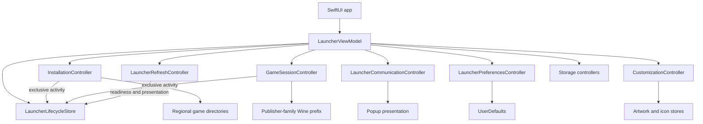
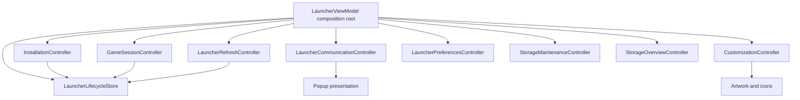

# Architecture

Arknights Client is a native SwiftUI launcher around a bundled Windows compatibility runtime. The
launcher owns downloads, updates, settings, diagnostics, and process state. It does not ship game
files. It does not run Wine until the user selects **Play**.

[`LauncherViewModel`](../../../Sources/ArknightsLauncherUI/State/LauncherViewModel.swift) is the
composition root. Read the system map first. Then read the page that matches your change.

## System map

Data and side effects flow through the feature controllers. Each view receives only the controller or
values it needs. The root is not a service locator.

An arrow means ownership or an explicit callback, not free two-way access. For example,
`InstallationController` can update lifecycle state. A view must not use `LauncherViewModel` to start a
download.

`LauncherViewModel` constructs the feature controllers and wires the few transitions that cross feature
boundaries. It does no network, filesystem, installation, Wine, audio, customization, or update work.
Put new policy in the owning feature.

Controllers never depend on `LauncherViewModel` or on singleton state. Feature views receive their
owning controller, or explicit values and actions.

Each long-lived state and each asynchronous task has one feature owner:

| Owner                             | Responsibility                                                                                       |
| --------------------------------- | ---------------------------------------------------------------------------------------------------- |
| `LauncherLifecycleStore`          | Exclusive activity, refresh state, launch readiness, status, failure UI                              |
| `InstallationController`          | Region, install directory, installed state, resumable install/update/repair tasks, progress, removal |
| `GameSessionController`           | Runtime discovery, prefix maintenance, launch options, Wine processes, Game Mode, diagnostics        |
| `IntelTranslationController`      | Rosetta preflight, installation, recovery state, launch eligibility                                  |
| `LauncherRefreshController`       | Concurrent configuration and branding refreshes, stale-result rejection, region transitions          |
| `CustomizationController`         | Artwork, Dynamic Theme, launcher and game icons, presets                                             |
| `BackgroundMusicController`       | Playlist parsing, playback, Now Playing metadata, fades, music-link presentation                     |
| `LauncherCommunicationController` | Launcher releases, announcements, Yostar notices, popup order                                        |
| `LauncherPreferencesController`   | Persisted settings and the region-aware server-reset timer                                           |
| `StorageMaintenanceController`    | Targeted DXMT, browser, and gallery cache cleanup                                                    |
| `StorageOverviewController`       | Async usage measurement for installations, runtime data, caches, logs                                |

The composition root owns these controllers:

The state tree has three separate concerns:

| State branch              | Answers                                     | Examples                                               |
| ------------------------- | ------------------------------------------- | ------------------------------------------------------ |
| `activity`                | Which exclusive work owns the game/runtime? | install, migrate, launch, run, stop                    |
| `refresh` and `readiness` | Which metadata and prerequisites are known? | configuration, installed version, Rosetta availability |
| `presentation`            | What does the user see or act on?           | status text, failure message, update prompt            |

- `LauncherLifecycleStore` is the single gate for mutually exclusive work. Installation, maintenance,
  and the Wine-backed game lifecycle can touch the same files, so they share it. See
  [Activity leases](launch-and-process-lifecycle.md#activity-leases).
- Refresh and presentation stay separate from activity. Metadata checks and error messages can exist
  while a game runs.
- Do not use a presentation message as a lifecycle lock.
- Do not clear an active lifecycle state because a refresh failed.

First-run setup is the separate `ArknightsOnboarding` feature. It has its own `@Observable` coordinator
and `UserDefaults` progress store. It never downloads files or persists launcher settings. Each step
calls the same region, installer, display, artwork, icon, update, and audio actions as the main
interface.

A mandatory launcher-update preflight runs before setup. Interrupted setup resumes at its saved step.
If the game is absent, setup returns to Region & Install.

## Targets

Each folder under `Sources` is one SwiftPM target. `Package.swift` is the source of truth for target
dependencies, linked products, and isolation settings. A target depends only on targets with a lower
number. The compiler rejects a cycle.

| No. | Target                      | Contains                                                                                                                                       | Depends on          | Linked products    |
| --- | --------------------------- | ---------------------------------------------------------------------------------------------------------------------------------------------- | ------------------- | ------------------ |
| 1   | `ArknightsInfrastructure`   | Feature-independent network and file I/O primitives (`FileSystem`, `Network`)                                                                  | none                | none               |
| 2   | `ArknightsCore`             | Cross-feature lifecycle state (`Core`), shared domain, configuration, persistence, diagnostics, UI contracts (`Shared`), and SwiftPM resources | 1                   | none               |
| 3   | `ArknightsCustomization`    | Artwork, icons, preset gallery                                                                                                                 | 1, 2                | none               |
| 4   | `ArknightsGameInstallation` | Installation, manifests, game-file compatibility components                                                                                    | 1, 2, 3             | `CCommonCrypto`    |
| 5   | `ArknightsGameRuntime`      | Wine runtime, Intel translation, playtime, storage                                                                                             | 1, 2, 3, 4          | none               |
| 6   | `ArknightsAudio`            | Background playback, Now Playing, settings, HUD controls                                                                                       | 2, 3                | `YouTubePlayerKit` |
| 7   | `ArknightsOnboarding`       | Resumable flow, progress persistence, step views                                                                                               | 2, 3, 4, 5          | none               |
| 8   | `ArknightsLauncherUI`       | Composition (`LauncherViewModel`), home, Settings, documents, popups, launcher updates                                                         | 1, 2, 3, 4, 5, 6, 7 | `Sparkle`          |
| 9   | `ArknightsClient`           | The executable. It holds only `Application`: the app entry point and the macOS lifecycle                                                       | 2, 6, 7, 8          | none               |

Each library target has an `Arknights<Name>Tests` target. `ArknightsClientTests` holds only
`Application` tests. `ArknightsClientIntegrationTests` and `ArknightsClientLiveContractTests` cover the
other levels. `ArknightsTestSupport` is a library target for shared test helpers. See
[Testing architecture](../testing.md).

Direction rules:

- `ArknightsInfrastructure` imports no other target. It receives limits and policy as init arguments.
  It does not decide if a response is a valid game manifest or how a controller shows an error.
- `ArknightsCore` names no feature type. `Core` names only `Shared` types. `Shared` names no `Core` type.
- A feature target never imports `ArknightsLauncherUI`. Composition code passes values and closures
  down.
- A symbol that another production target uses gets `package` access. Other symbols stay `internal`.
  Tests use `@testable import` and need no `package` access.
- Feature-specific components stay in their feature target. `Shared/UI/Components` holds only
  presentation contracts that multiple features use.
- A feature maps transport and storage errors at its own boundary.

`Package.swift` sets default actor isolation per target. `ArknightsAudio`, `ArknightsOnboarding`,
`ArknightsLauncherUI`, and `ArknightsClient` default to `MainActor`. The other targets are
`nonisolated` and mark controller types `@MainActor`.

Scripts derive configuration from `Resources/Info.plist` (product metadata), `Package.swift` (target
and resource layout), and `runtime.json` (runtime layout) through `scripts/lib/project_config.py`.
`ArknightsCore` owns the SwiftPM resources.

## Bundled resources

`Shared/Resources/BundledResource.swift` is the only place that names a file or directory in the app
bundle. Each entry states its path, kind, origin, and encoding.

| Origin    | Staged by                       | Read from                                                    |
| --------- | ------------------------------- | ------------------------------------------------------------ |
| `app`     | `scripts/build_app.py`          | `Bundle.main`                                                |
| `package` | `resources:` in `Package.swift` | `AppResourceBundle.bundle` (`Bundle.module` in SwiftPM runs) |

- Load a file with `BundledResource.data(in:)`, `text(in:)`, or `decode(_:in:)`. Do not call
  `Bundle.url(forResource:)` for a bundled resource.
- The loader throws `BundledResourceError`: `missing` (no such resource), `unreadable` (file system
  failure), or `corrupt` (invalid deflate data, UTF-8, or JSON). The owning feature maps the error.
- A file that the build copies from the repository stays `identity`: the bundle holds the same bytes as
  the source. A document that the build generates uses `deflate`. Today only `ThirdPartyNotices.deflate`
  does.
- `scripts/lib/bundled_resources.py` lists the same resources. `just check scripts` fails when the two
  lists differ. A new `package` resource also needs an entry in `Package.swift`.

## Platform boundary

The native side runs on Apple Silicon and macOS 15 or newer. The packaged Wine runtime is x86-64.
Before launch, the launcher verifies that macOS can run an Intel process through Rosetta 2.

The Wine prefix is not a macOS security sandbox. See
[Directory and drive contract](wine-prefix.md#directory-and-drive-contract) and
[Runtime compatibility](../../help/runtime-compatibility.md).

## Change guide

Before you change behavior, find its owner and external contract:

| Change                                   | Start here                                                     | Also update or verify                                                                                                         |
| ---------------------------------------- | -------------------------------------------------------------- | ----------------------------------------------------------------------------------------------------------------------------- |
| Game files, manifests, paths             | `ArknightsGameInstallation/Installation`                       | [Installation architecture](installation.md), installer tests                                                                 |
| Wine startup, prefix, process, display   | `ArknightsGameRuntime/Runtime`                                 | [Launch and process lifecycle](launch-and-process-lifecycle.md), [Runtime compatibility](../../help/runtime-compatibility.md) |
| Compatibility component or native bridge | `ArknightsGameInstallation/Compatibility` and `RuntimeSupport` | restore/update behavior, runtime notices, release validation                                                                  |
| Publisher endpoint, refresh              | `LauncherAPI` and `LauncherRefreshController`                  | [Communication and boundaries](communication-and-boundaries.md), live contracts                                               |
| Persisted setting, app-owned path        | `LauncherPreferencesStore` or `AppPaths`                       | [Data and persistence](data-and-persistence.md), storage tests                                                                |
| Launcher activity or lifecycle state     | `ArknightsCore/Core/Lifecycle`                                 | [Launch and process lifecycle](launch-and-process-lifecycle.md), lease tests                                                  |
| User-facing copy                         | the view that shows it (literals)                              | English literals and accessibility review                                                                                     |
