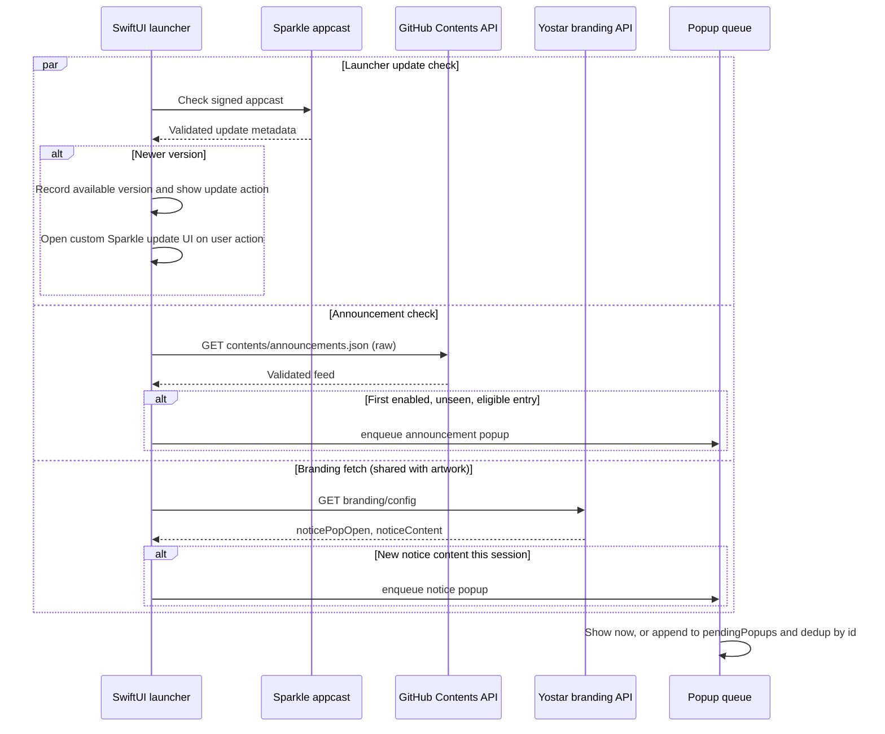
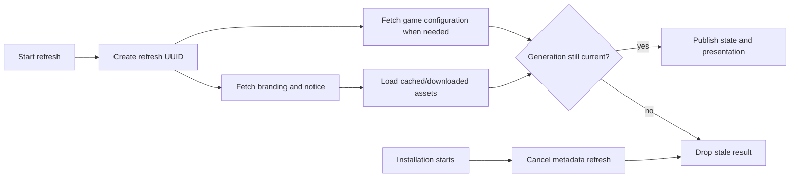

# Communication and boundaries

The launcher has no project-owned application server. Each remote source has its own owner,
validation policy, and failure path. Keep the channels separate when you add a message or update
surface.

## Launcher communication

Read-only channels feed the launcher. Each runs independently at launch, on its own precondition,
with no order between them. Announcements and Yostar notices can enqueue a popup. Launcher updates use
status state and the themed Sparkle UI.

| Channel                                                                 | Owner                         | Payload                                                   | User-visible result                                                |
| ----------------------------------------------------------------------- | ----------------------------- | --------------------------------------------------------- | ------------------------------------------------------------------ |
| Yostar game/config API (Global, Japan, Korea)                           | `LauncherAPI`                 | Region configuration, branding, CDN and manifest location | Readiness, artwork, region notice, or an actionable launcher error |
| Gryphline (Taiwan) and Hypergryph (China clients) metadata/payload APIs | `LauncherAPI`                 | Region configuration, branding, CDN and manifest location | Readiness, artwork, or an actionable launcher error                |
| Repository announcements                                                | `LauncherAnnouncementService` | Bounded JSON feed from `main`                             | Once-only Markdown popup with an optional HTTPS action             |
| Sparkle appcast                                                         | `LauncherUpdaterController`   | Signed launcher update metadata and archive               | Update status, then Sparkle's themed update UI on request          |
| Repository wallpaper tags                                               | `PresetCatalogService`        | Bounded `WallpaperTags.json` from `main`                  | Gallery search tags layered over the bundled manifest              |

- **Sparkle appcast** (`SUFeedURL`): The launcher checks it silently when automatic launcher-update
  checks are on, and before onboarding. A newer version becomes launcher status state and enables the
  update action. `LauncherUpdaterController` wraps `SPUUpdater` and `LauncherUpdateUserDriver`. Sparkle
  validates the feed and handles download, signature verification, replacement, and relaunch. The
  driver supplies the themed UI.
- **Update gate**: `LauncherUpdaterController` rejects checks while the lifecycle is installing,
  migrating, launching, or running the game. It postpones a pending relaunch until idle. A stale
  activity lease cannot change this gate. See
  [Activity leases](launch-and-process-lifecycle.md#activity-leases).
- **Announcements**: `checkAnnouncements()` reads the GitHub Contents API in raw form when
  announcements are on. [Announcements](../announcements.md) owns the feed schema, limits, and
  eligibility rules.
- **Wallpaper tags**: The Artwork gallery fetches the manifest once per launch. Cached tags apply
  before the network answers. [Wallpaper tagging](../wallpaper-tagging.md) owns the manifest rules.
- **Preset sources**: `PresetRemoteSources` names every community mirror and the Fankit gallery API.
  A failed fetch keeps the cached data.
- **Yostar branding response**: It rides on the `api.branding(region:)` call that `refresh()` already
  makes for hero artwork. If `noticePopOpen` is true and `noticeContent` differs from the last notice
  shown, the launcher converts the HTML to native attributed text and queues it. The guard is in
  memory only. It resets on every region switch and launch, so an active notice reappears each
  session.

The three launch checks run in parallel. They meet in one popup queue:

Announcements and Yostar notices share one queue (`enqueuePopup`):

- If nothing shows, the popup shows now and is recorded as seen. Otherwise it joins `pendingPopups` and
  is recorded as seen only when `dismissPopup` promotes it.
- The queue silently drops a duplicate ID of the shown or a queued popup.
- Announcements persist a set of seen IDs. Yostar notices keep nothing beyond the session. Their ID
  embeds a fresh UUID, so only the upstream content comparison catches a repeat.

## Refresh concurrency

`LauncherRefreshController` starts the game configuration and branding requests for the current region
independently. Each refresh receives a UUID generation.

- Cancelling a refresh invalidates its generation before a later task can publish.
- The controller accepts branding assets only when the refresh ID and active region both still match.
  A slow response from a previous region cannot replace current artwork, notices, or readiness.
- A late official image never replaces user-selected artwork. The controller captures a
  custom-artwork generation at refresh start and checks it again before it applies the asset.

This diagram shows the generation check:

> [!IMPORTANT]
> Every asynchronous remote result needs an ownership check before it mutates observable state.
> Cancellation alone is not enough: a request can complete between cancellation and its callback.

## Boundaries

- Game files come from first-party HTTPS endpoints. No release includes them.
- Manifest paths cannot escape the selected game directory. See
  [Installation architecture](installation.md#manifest-and-path-safety).
- The launcher never handles credentials or intercepts Vuplex pages. Remote action links must use HTTPS.
- [`RUNTIME.json`](../../../runtime.json) pins runtime versions and source revisions.

> [!WARNING]
> A popup or notice is not an authorization boundary. Keep remote content out of process execution,
> filesystem paths, and credentials. If a new feed needs more than text and an HTTPS action, define and
> review a separate contract. Do not expand the existing parser implicitly.

## Failure policy

Remote requests fail closed for the feature they serve:

- Branding request fails: cached or custom artwork and the last known state stay. An installed game
  stays available.
- Game configuration request fails: actionable when no game is installed. Logged and tolerated when an
  installed game has enough state.
- Announcements feed is unavailable: no popup. Launch is not blocked.
- Sparkle check fails: the launcher records the failure. The running launcher and the game continue.
  The onboarding preflight has its own update gate.

Never make an optional message or metadata source a lifecycle dependency without updating the state
model and recovery contract.

## Privacy and support boundary

The launcher collects no project telemetry. The website privacy page lists the hosts it contacts.
The embedded browser stays an official game helper. The compatibility components never inspect login,
payment, or page contents.

Route account, payment, and service issues to the publisher's official support. See the
[publisher support routing table](../../help/README.md#publisher-support-routing). Route launcher,
runtime, and packaging issues to the repository issue form. Before you share a log, remove account
identifiers and local paths.
