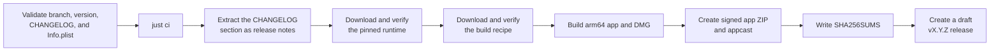

# Releases and updates

Each release is a complete Apple Silicon DMG with the launcher, Wine, DXMT, licenses, and an Applications shortcut. It never contains Arknights game files. [`runtime.json`](../../runtime.json) pins the tested runtime. [Runtime updates](runtime-updates.md) describes how to change the pin.

## Creating a release

> [!IMPORTANT]
> Merge the release branch, update local `main`, and run `just release X.Y.Z` from clean, pushed `main`. Or start **Draft release** from GitHub Actions on `main` and enter the version. The workflow rejects other branches, malformed versions, and existing tags or releases.

Check these inputs first:

| Input                   | Required state                                                                                                                                       |
| ----------------------- | ---------------------------------------------------------------------------------------------------------------------------------------------------- |
| `CHANGELOG.md`          | Non-empty `## [X.Y.Z]` section; it becomes the GitHub and Sparkle release notes                                                                      |
| `Resources/Info.plist`  | `CFBundleShortVersionString` exactly matches `X.Y.Z`; `SUPublicEDKey` stays the tracked release public key                                           |
| `runtime.json`          | Valid schema, HTTPS downloads, lowercase SHA-256 values, safe interface paths, paired provenance repositories and commits, intended `prefixRevision` |
| Working tree and `main` | Clean, on `main`, equal to upstream. `just release` checks all three                                                                                 |

The `pages` and `package` jobs run independently from the same commit. Pages requires `main`, runs `pnpm check`, and builds with `BASE_PATH=/Arknights-MacOS-Client`. A Pages failure does not stop the draft but keeps the workflow red.

The `package` job works in this order. It validates the branch, version, `CHANGELOG.md`, and `Info.plist`. It runs `just ci`. It extracts the changelog section as release notes. It downloads and verifies the pinned runtime and build recipe. It builds the arm64 app and DMG. It creates the signed update archive and appcast, writes `SHA256SUMS`, and creates the draft `vX.Y.Z` release.

This diagram shows the same order:

`just stats` shows DMG and Sparkle archive download counts, separated into manual packages and in-app updates. GitHub counts downloads, not unique users. Treat the totals as directional.

## Local packaging

Run `just dev` to download the pinned runtime and build the app. Run `just dev dmg` to continue to the installable DMG. `just runtime` only downloads the runtime. It verifies the SHA-256, extracts the archive safely, validates Wine and both DXMT architectures, and replaces `.build/runtime`.

Packaging compiles only the Swift launcher and the x86-64 components in `RuntimeSupport`, and changes Wine's staged menu shortcut from Option-Command-Q to Command-Q. It writes one compact `ThirdPartyNotices.deflate` file into the app. See [License automation](license-automation.md).

The draft contains:

| Asset                         | Purpose                                             |
| ----------------------------- | --------------------------------------------------- |
| DMG                           | Installable arm64 application and pinned runtime    |
| `.tar.xz` update archive      | Complete Sparkle update archive (0.6.x: `.zip`)     |
| `*.delta`                     | Sparkle binary deltas from recent releases          |
| `appcast.xml`                 | Signed Sparkle feed with embedded release notes     |
| `Runtime-Build-Recipe.tar.gz` | Pinned runtime build recipe and provenance metadata |
| `SHA256SUMS`                  | SHA-256 checksums for the published artifacts       |

The workflow attaches GitHub build-provenance attestations for the DMG, runtime recipe, and checksum file. Do not copy assets from `dist/` into the repository.

GitHub Actions dependencies use immutable commit pins with version comments. Every workflow declares bounded job runtimes and job-specific token permissions. Write access is limited to release publication, Pages deployment, live-contract failure issues, and wallpaper-tag issue filing.

## Release review

> [!WARNING]
> Keep the release as a draft until every item below passes. Published assets and version tags are never replaced. Fix a broken release with a higher version.

1. The source tag matches `CFBundleShortVersionString` and the release notes.
2. `Contents/Resources/RUNTIME.json` in the app matches the `runtime.json` that the build used. The runtime archive and build-recipe SHA-256 values match.
3. The runtime archive and build recipe are available at the pinned HTTPS URLs, and the recorded SHA-256 values verify them.
4. The runtime files match the declared interface: `bin/wine64`, `bin/wineserver`, `winemetal.dll`, the macOS driver, and the DXMT x64 library set. Runtimes before 0.7.0 also ship x32.
5. The component commits in `runtime.json` match the source links in [Third-party notices](../legal/third-party-notices.md).
6. The app bundle contains `LICENSE`, `RUNTIME.json`, and `ThirdPartyNotices.deflate`. The website publishes current [Third-party notices](../legal/third-party-notices.md) and [License texts](../legal/license-texts.md). **Settings → About → Third-Party Notices** shows the same list.
7. `scripts/licenses.py --check --strict --runtime .build/runtime` passes, and every shipped component has a verified license.
8. The release has a reviewed source and notice package for every bundled runtime component. For each library, a component-level record maps the exact version or revision, notices, preferred-form source, build scripts, and any relinkable material or offer that its terms require. Publish this material at a stable release-linked location. The packaging checks cannot decide this step. `Runtime-Build-Recipe.tar.gz` is a provenance record, not a corresponding-source archive. See [Source code](../legal/source-code.md).
9. Install, Update, Repair, and Play work from the DMG on a clean Mac.

If an artifact lacks a notice, has another runtime checksum, or points to the wrong tag, keep the release as a draft and open a repository issue with the version and asset.

## Versioning and changelog

Versions follow Semantic Versioning. Before 1.0, minor versions can contain deliberate compatibility changes and patch versions contain compatible fixes. User-visible work starts in `Unreleased` and moves to an `X.Y.Z` section before release. Use the `Added`, `Changed`, `Fixed`, and `Removed` headings.

The extractor accepts a `## [X.Y.Z]` heading with an optional ` - description` suffix. It takes content up to the next `## [` heading. It fails when the section is missing or empty.

## Signing and Sparkle updates

Releases are ad-hoc signed and not notarized. Users must follow the [installation guide](../installation.md) for Apple's **Open Anyway** flow. Sparkle signs updates separately with Ed25519 and replaces the complete app bundle through its helper. This does not remove the first-launch Gatekeeper confirmation.

The launcher checks for updates silently when it opens (the user can disable this in Settings). Sparkle owns download, verification, and installation. Game updates are checked separately and never download without a user action.

Clients read the appcast through the stable `releases/latest/download/appcast.xml` URL. Each release has a complete `.tar.xz` update archive (up to 0.6.x: `.zip`). Sparkle 2.9.6, the oldest shipped updater, extracts both.

The workflow creates the archives from the fully packaged app, preserving bundle symlinks and executable modes. It generates and signs the appcast with Sparkle's `generate_appcast`. Before it creates the draft, it validates the key pair and verifies the signed appcast bytes and every enclosure against the generated archive, including basename and byte length. This rejects a bad signature, tampered archive, wrong asset filename, or length mismatch before publication.

The workflow also checks that the bundle contains Sparkle.framework with symlinks and nested XPC and helper code intact, an `@executable_path/../Frameworks` rpath, inside-out ad-hoc signatures, and a final outer-bundle verification. For a release candidate, install the DMG, start a newer signed update from the launcher, and confirm the themed update UI and the download and restart flow. Repeat during an active game or installation to verify that replacement is deferred.

> [!CAUTION]
>
> - The current Sparkle public key, K0, is tracked in `Resources/Info.plist` as `SUPublicEDKey`. Every package build validates that it decodes to exactly 32 bytes.
> - The private key reaches GitHub Actions only through the protected `release` environment as `SPARKLE_ED25519_PRIVATE_KEY`. The workflow passes it to `generate_appcast` through standard input, never in arguments.
> - Export a current Sparkle `generate_keys -x` seed of exactly 32 decoded bytes. The workflow rejects legacy 96-byte key-pair exports.
> - Release validation derives the public key from the seed and compares it with K0 before upload.
> - Keep the private key in the macOS login Keychain and one separate encrypted offline recovery copy. Never commit it.
> - Local `just ci` and release signature verification need OpenSSL 3 or newer with Ed25519 support. macOS system LibreSSL lacks it. Install `openssl@3` locally and put its `bin` directory before the system tools in `PATH`.

Key rotation is deferred. Sparkle 2.9.6's `generate_appcast` adds no enclosure signature when the signing seed does not match the embedded public key. Each installed client authenticates the signed feed with its own key ([Sparkle's guide](https://sparkle-project.org/documentation/#rotating-signing-keys)). One replacement `appcast.xml` cannot serve both K0 and a new K1. Keep K0 until all of these are true:

- A bridge release can be signed explicitly with `sign_update`.
- The K0 and K1 generations have separate authenticated feed routes.
- Packaged A→B and B→C paths pass tests, including a lagging A client that still receives B after C is published.

Current clients are ad-hoc signed, so losing K0 requires an independently authenticated recovery path. A new Apple signing identity cannot repair it afterward.

### Delta updates

The Wine runtime is most of the bundle and rarely changes, so the workflow also publishes Sparkle binary deltas. Before `generate_appcast`, `scripts/sparkle_deltas.py fetch` downloads the full update archives of the newest published releases (`SPARKLE_DELTA_SOURCE_COUNT` in `scripts/lib/project_config.py`). `generate_appcast --maximum-versions 1 --maximum-deltas N` then builds one delta per source and keeps only the new version in the feed. Clients older than the oldest source, or that reject a delta, use the full archive.

Delta generation is best effort. A missing release, failed listing, or failed download logs a warning and skips that source. The complete archive still ships.

`generate_appcast` names deltas after the app bundle, but GitHub stores the asset with dots, which breaks the URL. `scripts/sparkle_deltas.py finalize` copies the referenced deltas into `dist/` under GitHub-safe names, rewrites their URLs, and signs the feed again with the K0 seed, because the signature covers those URLs. `validate_sparkle_keys.py --delta-directory dist` then verifies every delta's name, host, `sparkle:deltaFrom`, length, and Ed25519 signature. Deltas are in `SHA256SUMS` and the attestation.

Sparkle ignores the custom `Icon\r` file that `NSWorkspace.setIcon` writes into the bundle, so icon customization does not invalidate deltas. Any other bundle change makes Sparkle use the full archive.

## Onboarding after a release

The setup assistant always does one silent Sparkle check before version-specific onboarding, regardless of the automatic-check preference. If a newer release exists, setup stays pending and opens Sparkle's updater. It resumes after the newer launcher is installed and reopened. A failed network check does not block first-run setup.

To make every existing user rerun setup after a release, bump `OnboardingProgressStore.currentSchemaVersion`. Schema 2 shipped with 0.7.0. Preferences stay unchanged. Only setup progress resets.

To make the rerun mandatory, also add the new schema to `OnboardingProgressStore.requiredSchemaVersions` and give it a reason in `OnboardingStrings.requiredSetupReason(schema:)`. Returning players then see why, and Skip Setup stays hidden until they finish. First-time users can still skip. Schema 2 is required. In debug builds, the **Required** toggle next to **Onboarding preview** in the developer simulator shows this state.
